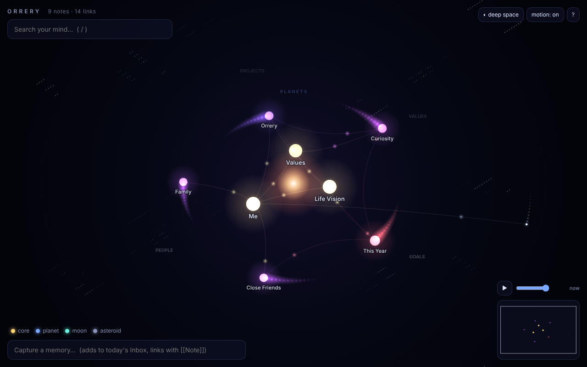

# ✦ Orrery

**Your mind as a living solar system, and a memory Claude can actually use.**

Orrery is a local-first, Obsidian-compatible markdown vault with a glowing orbit view and a tiny
MCP server. The centre is *you* (identity, values, vision). Projects, people and goals orbit as
planets, supporting notes as moons, loose thoughts as an asteroid belt. Links between notes are
glowing arcs with light pulsing along them. When Claude learns something durable, it writes it
back, and a new star ignites.



## Why it's cheap on tokens
Claude never reads your whole vault. It calls `get_brief` and gets a **token-budgeted digest** (default ≈1,800 tokens):

| Orbit | What the AI sees |
|---|---|
| core (identity, values, vision) | full text, capped |
| planets (projects, people, goals) | one-line summary + neighbours |
| moons | titles only |
| asteroids | a count; reachable via `search` |

Then `search` (snippets only) and `read_note` (one note + links/backlinks) fetch detail on demand.
`remember` appends new facts, wikilinked into the graph. A 10,000-note vault costs the same ~1.8k tokens to start a conversation.

## Quick start
Requires Node 20+.
```bash
git clone <this repo> && cd orrery
npm install --legacy-peer-deps      # works around an npm peer-dependency bug
npm run build
node dist/cli.cjs init              # creates ~/Orrery from the starter template
node dist/cli.cjs serve             # open http://localhost:4747
```
Desktop app: `npm run app` (launch verified under Xvfb: first-run vault creation, IPC, graph render). Installers: `npm run dist` (Windows .exe, macOS .dmg, Linux AppImage/.deb); tagging `v*` builds all three via GitHub Actions. Installer packaging itself is untested.

Use another vault (even an existing Obsidian vault): `ORRERY_VAULT=/path/to/vault` or `--vault`.

## Connect Claude (MCP)
```bash
node dist/cli.cjs mcp-config        # prints the JSON snippet
```
Or let Orrery do it: `node dist/cli.cjs setup-claude` shows the change, `--yes` writes it into Claude Desktop's config (other servers kept, old file backed up). For Claude Code: `claude mcp add orrery -- node /abs/path/dist/mcp.cjs` with `ORRERY_VAULT` set.
Tools: `get_brief`, `search`, `read_note`, `remember`, `update_note`, `link_notes`.

### Import your past Claude conversations
Export your data from Claude (Settings → Privacy → Export data), then:
```bash
node dist/cli.cjs import-claude ~/Downloads/claude-export.zip --dry-run   # preview
node dist/cli.cjs import-claude ~/Downloads/claude-export.zip             # write
```
Each conversation with durable first-person facts ("I live in…", "I decided…", "My best friend…") becomes a small note in `Conversations/` with those facts, provenance (`source_id`), and links to notes it mentions. Requests, questions and Claude's own replies are ignored; facts already in your vault are dropped; re-running only adds new conversations. Extraction is rule-based (no API key, nothing leaves your machine), so expect to prune a little. Use `--all` to also keep conversations with no facts as asteroids.

To make Claude use it every time, add this to your Claude custom instructions / project instructions / `CLAUDE.md`:
> At the start of every conversation call `orrery.get_brief`. Use `search` before asking me things you may already know. When I share a durable fact, decision or preference, call `remember` with a one-line note and `[[wikilinks]]` to related notes. Never dump transcripts.

## Vault format
Plain `.md` files. Optional frontmatter: `summary:` (one-liner used in the brief), `orbit: core|planet|moon|asteroid`, `tags: [a, b]`.
Without `orbit:`, folders decide (`Core/` → core; `Values/ Projects/ People/ Goals/` → planet); everything else is placed by link count. `[[wikilinks]]` become edges.

## Controls
`/` search · click a body to open it · hover to light its connections · scroll to zoom · drag to pan · capture box adds to today's Inbox.

## Status & roadmap
Phase 0-2 core is working (see [docs/BUILD_PROMPT.md](docs/BUILD_PROMPT.md) for the phased plan and ready-to-paste prompts). Not yet done: LLM-quality fact distillation (import is rule-based), in-app editing, packaged-installer testing, embeddings.

> This repo was previously a placeholder for an Android reading app ("Marginalia"); it now hosts Orrery.

## Privacy
Everything stays on your machine. No accounts, no telemetry, no network calls. The server binds to `127.0.0.1`.

MIT licensed.
